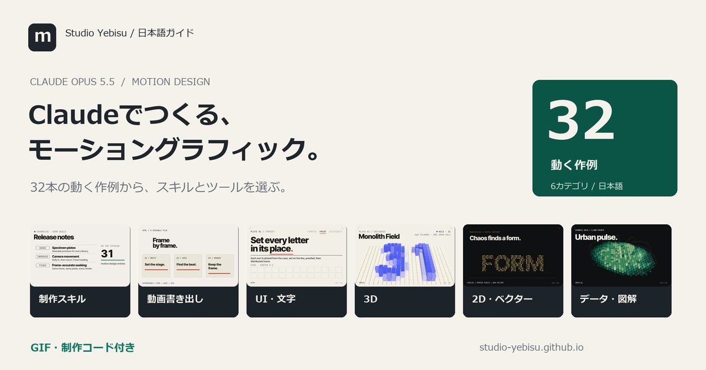

# Claude モーショングラフィック制作ガイド

Claude Opus 5.5を使ったモーショングラフィック制作のための日本語ガイド。制作スキル、描画ライブラリ、書き出しエンジンを用途から選べます。

**[まとめサイトを開く](https://studio-yebisu.github.io/awesome-claude-motion-design-ja/)** · **[全31件の検索・比較](https://studio-yebisu.github.io/awesome-claude-motion-design-ja/projects.html)** · **[スタックの組み方](https://studio-yebisu.github.io/awesome-claude-motion-design-ja/guide.html)**

元になった[damkinさんのXポスト](https://x.com/damkina7/status/2109275362660130919)の10件に、一次資料を確認した21件を追加。確認日：2026年10月12日（日本時間）。



## まず何を選ぶか

| つくりたいもの | 構成の入口 | 詳細 |
| --- | --- | --- |
| HTMLで短い商品紹介・文字演出 | HyperFrames + 公式制作スキル + 時刻指定できるアニメーション | [HTML動画のルート](https://studio-yebisu.github.io/awesome-claude-motion-design-ja/guide.html#html) |
| 差し替えて使う動画テンプレート | Remotion + 公式Agent Skills + React | [React動画のルート](https://studio-yebisu.github.io/awesome-claude-motion-design-ja/guide.html#react) |
| 触れるUI・製品サイト | MotionまたはGSAP + Emil Kowalski Skills | [Webのルート](https://studio-yebisu.github.io/awesome-claude-motion-design-ja/guide.html#web) |
| 数式・仕組みの解説 | ManimまたはMotion Canvas + 場面の構成表 | [解説動画のルート](https://studio-yebisu.github.io/awesome-claude-motion-design-ja/guide.html#explain) |

これらは資料をもとにした編集上の提案です。Opus 5.5に全体設計とスキル適用・実装を相談し、各項目に専用作例を制作しました。モデル間の性能比較は行っていません。

## Claudeと各ツールの役割

Claudeが構成やコードをつくり、描画・動画化はブラウザやレンダラーが行います。スキルは制作の判断基準と進め方を伝えるもので、単体の動画エンジンではありません。ライブラリの多くは特定モデル専用ではありません。

[Anthropicのモデル設定ガイド](https://code.claude.com/docs/en/model-config)に従い、`claude --model claude-opus-5-5`で版を指定できます。`/status`で現在のモデルを確認します。

## 用途別一覧


### 制作スキル・事例（8件）

| スキル・ツール | 使いどころ | ライセンス | 出所 |
| --- | --- | --- | --- |
| [Remotion Agent Skills](https://github.com/remotion-dev/skills) | Reactで動画をつくるときの基本セット。 | [独立LICENSE未確認](https://github.com/remotion-dev/skills/blob/7ba4dcf8ebe1626b00baa41e1f2478113719b60b/README.md) | 追加調査 |
| [Emil Kowalski Skills](https://github.com/emilkowalski/skills) | UIデモの動きや、操作に対する反応を磨く。 | [MIT](https://github.com/emilkowalski/skills/blob/2d228630ba1446365f614a108cb8252f1feda202/LICENSE) | 追加調査 |
| [Motion Graphics Skill Pack](https://github.com/charlie947/motion-graphics-skills) | 短い告知動画を、ブランドに沿った構成でつくる。 | [MIT](https://github.com/charlie947/motion-graphics-skills/blob/229022ebca76972e119e36ada23a1648d51665ab/LICENSE) | 追加調査 |
| [claude-motion](https://github.com/whaleyxbt/claude-motion) | 映像と音を同じ時刻表に合わせる。Webシミュレーションの動画化にも。 | [MIT](https://github.com/whaleyxbt/claude-motion/blob/e627941543d9988b155dc610bb9cc0115a5e365e/LICENSE) | 追加調査 |
| [claude-motion-design](https://github.com/howseen-ai/claude-motion-design) | 商品紹介やUIの変形を、音のタイミングに合わせてつくる。 | [MIT](https://github.com/howseen-ai/claude-motion-design/blob/3d90d349ef3fdde9b7e89de4df4a2159c9e8697f/LICENSE) | 追加調査 |
| [/motion for Claude Code](https://github.com/abhimahamkali/claude-motion-skill) | 比喩や図形で伝える短い解説動画。 | [LICENSE未確認](https://github.com/abhimahamkali/claude-motion-skill/blob/37d44b5d2db8e28c4ebf011cb8f1bd1e260ac09c/README.md) | 追加調査 |
| [iart.ai Motion Skills](https://github.com/iart-ai/motion-skills) | つくりたい表現に合わせて、必要なパックを選ぶ。 | [MIT（索引）](https://github.com/iart-ai/motion-skills/blob/4a9822375b589294aa369fde44205c62dfcf9c27/LICENSE) | 追加調査 |
| [Opus 5.5 Video Prompts](https://github.com/apimodels/claude-opus-5-5-video-prompts) | 良い制作指示の粒度や、映像ごとの技術選択を調べる。 | [CC BY 4.0（編集資料）](https://github.com/apimodels/claude-opus-5-5-video-prompts/blob/383335d1ed1a6a6d84b772d7c802ca0d221f6410/LICENSE) | 追加調査 |

### 動画制作・書き出し（7件）

| スキル・ツール | 使いどころ | ライセンス | 出所 |
| --- | --- | --- | --- |
| [HyperFrames](https://github.com/heygen-com/hyperframes) | HTMLで組む商品紹介、文字演出、SNS動画。 | [Apache-2.0](https://github.com/heygen-com/hyperframes/blob/fbbc4e88c59c01bfec69368a9a587d3438a7d32a/LICENSE) | 追加調査 |
| [Remotion](https://github.com/remotion-dev/remotion) | 再利用する動画テンプレート、字幕、データを差し替える量産。 | [Remotion License](https://github.com/remotion-dev/remotion/blob/d5f455390933ab7a48d6ca79a5f4f0223234a802/LICENSE.md) | 追加調査 |
| [Motion Canvas](https://github.com/motion-canvas/motion-canvas) | 仕組みを順番に見せる図解や、技術説明の動画。 | [MIT](https://github.com/motion-canvas/motion-canvas/blob/7b91435c301d530351dcf5ebb91dd139c002e405/LICENSE) | 追加調査 |
| [FFmpeg](https://github.com/FFmpeg/FFmpeg) | レンダラーの出力をMP4にし、音声を合わせて納品する。 | [LGPL／GPL（構成による）](https://github.com/FFmpeg/FFmpeg/blob/6ef3b1ba966233a0964bcc4aa1c2e20d014a5052/LICENSE.md) | 追加調査 |
| [ffmpeg.wasm](https://github.com/ffmpegwasm/ffmpeg.wasm) | ファイルを利用者のブラウザ内で処理するWebツール。 | [MIT（wrapper）＋coreの条件](https://ffmpegwasm.netlify.app/docs/faq/#what-is-the-license-of-ffmpegwasm) | 元ポスト |
| [Mediabunny](https://github.com/Vanilagy/mediabunny) | ブラウザで動く編集・書き出し機能を実装する。 | [MPL-2.0](https://github.com/Vanilagy/mediabunny/blob/cc108b3b492d1e00aa976586b6d3f344a0bd178d/LICENSE) | 追加調査 |
| [Playwright](https://github.com/microsoft/playwright) | seek(t)で描いた各フレームの取得と、表示崩れの検査。 | [Apache-2.0](https://github.com/microsoft/playwright/blob/d9f2fd3e2232ace8e317a84eda6cb86e25bcf49c/LICENSE) | 追加調査 |

### UI・文字のアニメーション（4件）

| スキル・ツール | 使いどころ | ライセンス | 出所 |
| --- | --- | --- | --- |
| [Motion](https://github.com/motiondivision/motion) | 操作に応じるUI、画面の切り替え、製品デモの部品。 | [MIT](https://github.com/motiondivision/motion/blob/e6bf03ead39cae7a2c5f8fe902ce8a9c1a9a22e8/LICENSE.md) | 元ポスト |
| [GSAP](https://github.com/greensock/GSAP) | 文字演出や複数要素の連動。HTML動画ではpaused timelineの時刻指定が入口。 | [GSAP独自ライセンス](https://gsap.com/community/standard-license/) | 追加調査 |
| [Anime.js](https://github.com/juliangarnier/anime) | ロゴの線、図形の変化、複数の文字の時間差演出。 | [MIT](https://github.com/juliangarnier/anime/blob/01b81be1df6843ccfe0a71c0699a746bf740dd77/LICENSE.md) | 追加調査 |
| [canvas-confetti](https://github.com/catdad/canvas-confetti) | 達成、完了、祝福を短く伝える演出。 | [ISC](https://github.com/catdad/canvas-confetti/blob/20eebad51dde793070c373d594099a7ed8d96e22/LICENSE) | 元ポスト |

### 3D・シェーダー（5件）

| スキル・ツール | 使いどころ | ライセンス | 出所 |
| --- | --- | --- | --- |
| [Three.js](https://github.com/mrdoob/three.js) | 立体ロゴ、製品の回転、奥行きのある文字や空間。 | [MIT](https://github.com/mrdoob/three.js/blob/2a8cd874803effdc99cf2db0cd0ff2f683d69389/LICENSE) | 元ポスト |
| [React Three Fiber](https://github.com/pmndrs/react-three-fiber) | ReactのUIと3Dシーンを同じプロジェクトで管理する。 | [MIT](https://github.com/pmndrs/react-three-fiber/blob/9e53355ce499ea518ac3729de7fd4dcc06d8cdb9/LICENSE) | 追加調査 |
| [Drei](https://github.com/pmndrs/drei) | 3D製品ビューの環境や操作、文字の配置を組む。 | [MIT](https://github.com/pmndrs/drei/blob/bf6f4addf47467d3885de272d94ca5127f6ef68f/LICENSE) | 元ポスト |
| [Cobe](https://github.com/shuding/cobe) | 拠点、国際展開、ネットワークを伝える小さな地球儀。 | [MIT](https://github.com/shuding/cobe/blob/7e94076fa8c38707f4c9cd114ff4f7c5c880971e/LICENSE) | 元ポスト |
| [TWGL.js](https://github.com/greggman/twgl.js) | 独自のシェーダーや背景効果を、小さく実装する。 | [MIT](https://github.com/greggman/twgl.js/blob/aa33c0aa5b095e57b9a5cde0cf241e66a6c95f2e/LICENSE.md) | 元ポスト |

### 2D・ベクター（4件）

| スキル・ツール | 使いどころ | ライセンス | 出所 |
| --- | --- | --- | --- |
| [Fabric.js](https://github.com/fabricjs/fabric.js) | テキストや図形を動かす編集ツール、図解の部品管理。 | [MIT](https://github.com/fabricjs/fabric.js/blob/54f050648cb67f7066b108f63cf1824039860d92/LICENSE) | 元ポスト |
| [Rive Runtimes](https://github.com/rive-app/rive-runtime) | 入力や状態に応じて変わるキャラクター、ボタン、案内。 | [MIT（runtime）](https://github.com/rive-app/rive-runtime/blob/daf55385b71fb861b2a1ae2930ae4492832d5db5/LICENSE) | 元ポスト |
| [Lottie Web](https://github.com/airbnb/lottie-web) | 既存のロゴ、アイコン、イラストの動きを画面や動画へ組み込む。 | [MIT](https://github.com/airbnb/lottie-web/blob/bede03d25d232826e0c9dca1733d542d8a7754fb/LICENSE.md) | 追加調査 |
| [PixiJS](https://github.com/pixijs/pixijs) | 粒子、キャラクター、要素の多い2Dシーン。 | [MIT](https://github.com/pixijs/pixijs/blob/65552017d23255c1442a7d4ac7f0d49e3225fb1d/LICENSE) | 追加調査 |

### データ・図解（3件）

| スキル・ツール | 使いどころ | ライセンス | 出所 |
| --- | --- | --- | --- |
| [deck.gl](https://github.com/visgl/deck.gl) | 地図上の流れ、移動、分布を見せるデータ表現。 | [MIT](https://github.com/visgl/deck.gl/blob/d9e395c935d962740e4b6debb7b63e1b4391b1b5/LICENSE) | 元ポスト |
| [D3](https://github.com/d3/d3) | 数値が変わるグラフ、統計の比較、独自の図解。 | [ISC](https://github.com/d3/d3/blob/ca958d45217b4c15332d971b935451a6d4c978f4/LICENSE) | 追加調査 |
| [Manim Community](https://github.com/ManimCommunity/manim) | 数学、アルゴリズム、仕組みの解説を動画にする。 | [MIT](https://github.com/ManimCommunity/manim/blob/a6d5cc02b430fb57d22add51236b6406fbf19d91/LICENSE) | 追加調査 |

## 調査と表示の範囲

- 一次資料：各公開リポジトリのREADME、公開ライセンス、公式ドキュメント。
- 確認した版とGitHub star数は[data/verification.json](data/verification.json)に記録。star数はリポジトリ全体の値で、品質や利用者数を表しません。
- 作者が公開した作例・実績と、このガイドでの検証を区別しています。全31項目に専用の動画を制作。描画、処理、スキル適用、公式素材の再生、参考資料の方法適用を各作例の説明で区別しています。
- RemotionとGSAPは独自条件のあるソフトウェア。LICENSE未確認の公開スキルや参考資料も、明示した上で掲載しています。
- サイトの動く作例は実行したMP4。全件にGIF・ポスター・制作コードを掲載。[制作記録](docs/作例の制作記録.md)と[data/preview-production.json](data/preview-production.json)で使用版、役割、実出力を確認できます。
- Riveのrocket.rivは公式MITテスト素材で、独自制作の.rivではありません。iart索引からはkinetic-typographyパックを選択。事例集は制作方法の参照として適用しました。
- 詳細は[調査ノート](docs/調査ノート.md)、[出典とライセンス](docs/出典とライセンス.md)、[制作スタック](docs/制作スタック.md)へ。

## ローカルで表示する

Python 3だけで表示・再生成できます。サイト閲覧のためのnpm依存はありません。

```text
python scripts/build_site.py
python scripts/check_site.py
python -u -m http.server 0 --bind 127.0.0.1
```

ターミナルに表示されたローカルURLを開いてください。空いているポートを使います。公開はGitHub Pagesの`main`ブランチ、ルートディレクトリを使用します。

編集対象は[data/curation.json](data/curation.json)、[templates](templates/)、[assets](assets/)。`index.html`、`projects.html`、`data/projects.json`、このREADMEはビルド生成物です。

一次資料の更新は[scripts/collect_sources.py](scripts/collect_sources.py)で行えます。`--evidence-dir`には公開リポジトリの外を指定し、取得した第三者READMEをサイトに再配布しないでください。

## 関連ガイド

[AIスライド制作ガイド](https://studio-yebisu.github.io/awesome-codex-ppt-skills-ja/) · 編集：StudioYebisu

## ライセンス

本ガイドのオリジナル文章、データ、コード、図版はMIT。掲載先のコード、素材、名称、事例には、それぞれのライセンス・利用条件が適用されます。Anthropicおよび掲載プロジェクトの公式サイトではありません。
